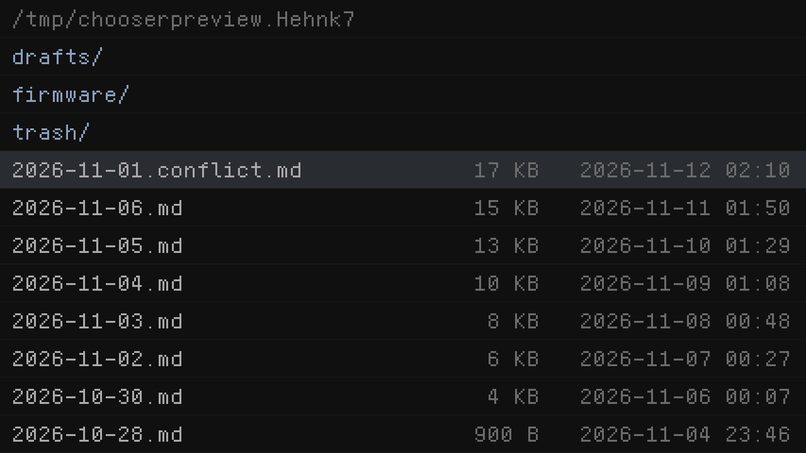
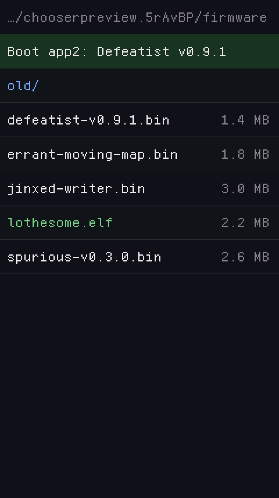

# feckless_chooser

A file chooser for the Tab5's apps (9012): one folder's entries a row
each -- folders first, files with their size and date -- moved through
with a USB keyboard or by taps, into folders and back out. The entries
come from `feckless_storage_handler`'s `storage_list.h`, read in one
pass with the volume held only for the read.

Like `feckless_keyboard` and `mailform` it owns no hardware and no task.
The app gives it a rectangle, colours and a text size, draws it and
blits, and hands it input:

```c
static chooser_t ch = {                 /* static: it holds a path */
    .x = 0, .y = 0, .w = 1280, .h = 720, .row_h = 60, .scale = 3,
    .bg = BG, .alt = BG, .sel = SEL, .text = TEXT, .dim = DIM, .folder = DIR, .rule = RULE,
    .root = "/sd/jinxed", .sort = STORAGE_SORT_NEWEST, .filter = notes,
    .show_path = true, .show_size = true, .show_time = true,
};

chooser_begin(&ch, NULL);
for (;;) {
    chooser_draw(&ch);
    gfx_blit(0, gfx_h());
    chooser_result_t r = CHOOSER_NONE;
    while (r == CHOOSER_NONE) {
        if (key_waiting()) r = chooser_key(&ch, my_key_to_chooser(key));
        else if (tapped(&x, &y)) r = chooser_tap(&ch, x, y);
        else r = chooser_poll(&ch);     /* a card came or went */
    }
    if (r == CHOOSER_OPEN) { chooser_sel_path(&ch, path, sizeof path); break; }
    if (r == CHOOSER_CANCEL) break;
    if (r == CHOOSER_KEY) { /* the app's own keys: rename, delete, ... */ }
}
chooser_done(&ch);
```

- **Keys:** Up, Down, PageUp, PageDown, Home, End; Enter opens a folder
  or chooses a file; Back (Backspace or Left) goes up a folder and lands
  on the one left; Escape cancels; a letter goes to the next row that
  starts with it. Any other key comes back as `CHOOSER_KEY` for the app.
- **Taps:** a row opens what it lands on; the path line goes up; the
  scroll bar, drawn only when there is more than fits, pages.
- **What is listed** is the filter's (`storage_list_read()`'s), which can
  tag each entry with a kind. `decorate` adds rows of the app's own after
  each read -- pinned ones first, chosen rather than entered, as
  Avoidant's "Boot app2" -- and `colour` colours a row by its kind.
- **`root`** NULL lists the volumes present first; a folder keeps the
  chooser inside it.
- **Narrow screens** drop the date, then the size, so a name keeps at
  least half the row.

Linked into an app's ELF (`ELF_COMPONENTS`): its gfx calls are the core
list's, its storage calls the ABI's storage section (9011).

Drawn by the real gfx (`make -C test preview`): Jinxed Writer's page,
landscape at size 3, newest first; Avoidant's menu, portrait, with its
pinned row and its `.elf`s in green.





MIT licence: `LICENSE`.
